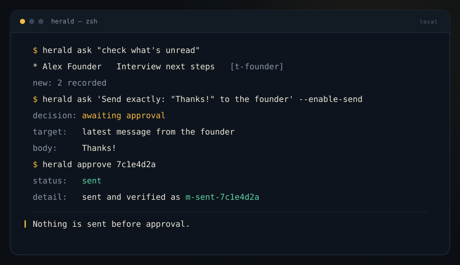
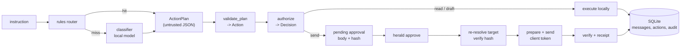

<p align="center">
  
</p>

<h1 align="center">Herald</h1>

<p align="center">A local-first communication agent. Your mail is read on your machine, drafted by a local model, and sent only after you approve the exact message.</p>

<p align="center">
  <a href="https://github.com/haroon0x/herald/actions/workflows/ci.yml"></a>
  <a href="LICENSE"></a>
  <a href="rust-toolchain.toml"></a>
  <a href="#install"></a>
  <a href="CHANGELOG.md"></a>
</p>

- **Nothing sends itself.** Every outbound message becomes a pending approval that shows the provider, the resolved thread, the exact body, and its SHA-256 hash. `herald approve` is the only path to the wire.
- **Nothing leaves the machine by default.** Deterministic rules and a small local model do the planning. No telemetry, no cloud inference, and `init` never writes a credential; SMTP passwords come from the environment.
- **Nothing is retried blindly.** Writes are idempotent on a client token, and a timeout ends in `uncertain`, which is resolved by reading the Sent folder, not by sending again.

## Why Herald

**The trust boundary is the product.** A communication agent with your account is a program that can speak as you. Herald keeps that authority in Rust: the model emits a typed `ActionPlan` and never touches a provider. Validation, target resolution, policy, and execution are separate, testable steps.

**Inference is local.** Planning uses a rules router first and a grammar-constrained classifier only when the rules miss. The classifier picks one of seven operations, a clarification flag, a target phrase, and the question it would ask. A 0.8B model is enough because it is never asked to hold intent, schema, and wording in one request.

**Approval comes before every send.** `allow_send` defaults to `false`. When it is enabled, each send still writes a pending approval with the body and hash. `approve` re-resolves the thread immediately before sending, refuses if the target changed, and verifies the result. There is no posting lane and no auto-send; see [ADR 0011](docs/decisions/0011-no-posting-lane.md).

**Writes are idempotent and auditable.** Each action carries a client token. A second send with the same token returns the existing receipt. Every state change is appended to an audit log, and the state machine rejects illegal transitions at the storage layer.

## 60-second demo

The demo provider is an in-memory inbox with two seeded conversations. Nothing here needs a network, a model, or an account.

<p align="center"></p>

```console
$ herald init
Herald 1.0.0
data:       /home/you/.local/share/herald
database:   /home/you/.local/share/herald/herald.db
config:     /home/you/.config/herald/config.toml (written)
manifest:   /home/you/.local/share/herald/models/manifest.json (written)

Nothing is connected yet. Try the demo inbox:
  herald ask "check what is unread"
  herald ask 'send exactly: "Thanks, I will review this." to the founder' --enable-send

To read real mail, edit the [maildir] section in the config, then run:
  herald doctor

$ herald ask "check what's unread"
provider:   fake
operation:  list_unread_messages
target:     check what's unread

* Alex Founder <alex@example.com>   Interview next steps   [t-founder]
  id: m-founder-2
* Alex Founder <alex@example.com>   Interview next steps   [t-founder]
  id: m-founder-1
new:        2 recorded
```

A send with no conversation named is refused rather than guessed:

```console
$ herald ask 'Send exactly: "Thanks, I will review this."' --enable-send
error: no thread matches "Send exactly: \"Thanks, I will review this.\""
```

Name the thread, and the same body becomes an approval:

```console
$ herald ask 'Reply to the latest from Alex Founder, send exactly: "Thanks, I will review this."' --enable-send
provider:   fake
operation:  send_reply
target:     latest message from Alex Founder
body:       Thanks, I will review this.
hash:       4f9c2b7e0d1a8c3f5e6b9d0a2c4e8f17b3d5a9c1e7f2b4d6a8c0e3f5b7d9a1c2

Approval required
action:     7f3c1a2e-9b04-4c6d-8f1a-2d5e6b7c8d90
provider:   fake
target:     latest message from Alex Founder
thread:     t-founder
body:       Thanks, I will review this.
hash:       4f9c2b7e0d1a8c3f5e6b9d0a2c4e8f17b3d5a9c1e7f2b4d6a8c0e3f5b7d9a1c2
expires:    2026-11-07 11:20:00Z

Nothing has been sent. To send exactly this body:
  herald approve 7f3c1a2e-9b04-4c6d-8f1a-2d5e6b7c8d90
To discard it:
  herald reject 7f3c1a2e-9b04-4c6d-8f1a-2d5e6b7c8d90

$ herald approvals
1 approval(s) waiting

action:     7f3c1a2e-9b04-4c6d-8f1a-2d5e6b7c8d90
provider:   fake
target:     latest message from Alex Founder
thread:     t-founder
body:       Thanks, I will review this.
expires:    2026-11-07 11:20:00Z

Approve exactly one body with `herald approve <action-id>`; reject with `herald reject <action-id>`.

$ herald approve 7f3c1a2e-9b04-4c6d-8f1a-2d5e6b7c8d90
action:     7f3c1a2e-9b04-4c6d-8f1a-2d5e6b7c8d90
status:     sent
detail:     sent and verified as m-sent-7f3c1a2e-9b04-4c6d-8f1a-2d5e6b7c8d90
message:    m-sent-7f3c1a2e-9b04-4c6d-8f1a-2d5e6b7c8d90

$ herald history
ACTION                               OPERATION                STATE        PROVIDER           TARGET
7f3c1a2e-9b04-4c6d-8f1a-2d5e6b7c8d90 send_reply               succeeded    fake               latest message from Alex Founder
c1d2e3f4-5a6b-4c7d-8e9f-0a1b2c3d4e5f list_unread_messages     succeeded    fake               unread
```

`--enable-send` enables the approval path. It does not send anything, and neither does `ask`. The message exists only after `approve` re-resolves the thread, checks the body hash, sends, and verifies the copy.

## Install

Prebuilt binaries for Linux, macOS, and Windows are on the [releases page](https://github.com/haroon0x/herald/releases/latest). Unpack, put `herald` on your `PATH`, done.

With Cargo (Rust 1.98 or newer):

```bash
cargo install --git https://github.com/haroon0x/herald --locked herald-agent
```

From source:

```bash
git clone https://github.com/haroon0x/herald
cd herald
cargo build --release -p herald-agent
./target/release/herald --version
```

The installed binary is `herald`; the package is `herald-agent`.

## Quickstart

Start with the demo provider. It needs no configuration and no model.

```bash
herald init                 # data dir, database, starter config
herald doctor               # paths, storage, providers, SMTP, model
herald providers            # what this build can talk to
herald ask "check what is unread"
herald ask "show me the latest from the founder"
```

Then connect your mail. Herald reads a local Maildir and sends through SMTP. Without an `[maildir.smtp]` block the provider is read-only.

```toml
# ~/.config/herald/config.toml
default_provider = "maildir"

[maildir]
path = "~/Mail"
sent_path = "~/.Sent"              # default: <path>/.Sent
from = "Me <me@example.com>"

[maildir.smtp]
host = "smtp.example.com"
port = 587
username = "me@example.com"
password_env = "HERALD_SMTP_PASSWORD"
security = "starttls"              # starttls | tls | none
```

```bash
export HERALD_SMTP_PASSWORD='...'   # never written to config.toml
herald doctor
herald inbox --unread
herald ask "summarize the thread from Sam"
herald ask 'Reply to the latest from Sam, send exactly: "Thursday works."' --enable-send
herald approvals
```

`herald doctor` reports a missing password, a malformed SMTP block, a Maildir it cannot read, and a model file that is absent or unverified. Fix those before approving anything.

## How it works



The full design is in [docs/architecture.md](docs/architecture.md). The short version: the model classifies, Rust decides, the provider executes, SQLite remembers.

Herald drives a browser in exactly one place: the X adapter. X has no free API for this use case, so `herald x login` opens a visible window on a dedicated profile, you sign in, and later commands drive the same profile with a fixed set of selectors. No selector, URL, or script ever comes from the planner, and a challenge or unexpected page is a hard stop. Mail still uses Maildir and SMTP. The X adapter is for reading mentions and DMs and for approval-gated replies and DMs only; tweet generation and posting live in the separate Zyquor pipeline. See [ADR 0008](docs/decisions/0008-x-browser-adapter.md) and [ADR 0011](docs/decisions/0011-no-posting-lane.md).

## Safety model

| Threat | Control |
| --- | --- |
| Model tries to execute an action | It emits JSON only. `validate_plan` maps it to a closed `Action` enum; there is no tool registry and no "run this" field. |
| Prompt injection in message text | Retrieved text is wrapped in `<untrusted-message>` blocks and labelled as data. The planner prompt and the provider input surfaces have injection tests. |
| Send without consent | `allow_send` defaults to false. Every send writes an approval row; `approve` re-resolves the thread and re-checks the body hash. There is no auto-send and no posting lane. |
| Duplicate send after a timeout | Client token plus `X-Herald-Token` plus a Sent-folder check. `uncertain` is reconciled, never retried. |
| Content leaving the machine | Local inference is the default. A remote endpoint works only if you configure one, and `doctor` says so. |
| Reading your whole mailbox | Reads are explicit commands with bounded limits. Only message metadata is stored; bodies are not kept after a decision. |
| Secret leakage | Passwords come from the environment, are never logged, and are never written by `init`. |

## Models

The model is optional. Rules cover the common commands, and `--engine rules` never starts an inference server.

| Backend | Config | Notes |
| --- | --- | --- |
| `none` | `[model] backend = "none"` | Rules and explicit bodies only. Default on a fresh install. |
| `managed` | `[model] backend = "managed"` | Herald runs a pinned GGUF through `llama-server` on loopback with a per-run token. |
| `openai` | `[model] backend = "openai"` + `endpoint` | Any OpenAI-compatible server: Ollama, LM Studio, vLLM. Use a local URL unless you mean to send content off the machine. |

Recommended: **Qwen3.5-0.8B Q4_K_M** (about 0.5 GB). It is fast on CPU and small enough for a seven-way classification with a grammar constraint; the eval harness measures quality on your machine. Qwen3.5-2B Q4_K_M is the step up if you have the memory and want better drafts.

```bash
herald model pin ./Qwen3.5-0.8B-Q4_K_M.gguf   # record the digest and provenance
herald model status                           # backend, manifest, file, digest
herald model verify                           # re-check the file on disk
```

`herald model download` fetches a manifest that points at a pinned remote artifact; it refuses a placeholder digest and a file whose digest does not match. `herald model pin` is the offline path: it hashes a GGUF you already have. The sidecar binds to `127.0.0.1` only; there is no config field that can expose it to the network.

## Commands

| Command | What it does |
| --- | --- |
| `herald init [--force]` | Create the data directory, database, and starter config. |
| `herald doctor` | Check paths, permissions, storage, provider health, Maildir, SMTP, model, and secrets. |
| `herald ask "<instruction>"` | Plan and run a request. Sends stop at an approval. |
| `herald plan "<instruction>"` | Dry run: print the plan, validation result, and policy decision. No writes. |
| `herald inbox [--unread] [--limit N]` | List recent messages. |
| `herald thread <id>` | Print one conversation. |
| `herald approvals` | List pending approvals with the body preview, thread, and expiry. |
| `herald approve <action-id>` | Re-resolve, verify, send, verify again, record a receipt. |
| `herald reject <action-id>` | Cancel the action and delete the retained body. |
| `herald reconcile <action-id>` | Resolve an `uncertain` send by looking for it in Sent. |
| `herald history [--limit N]` | List recorded actions and their states. |
| `herald audit [--limit N]` | Print the append-only audit log. |
| `herald providers` | Show implemented and planned providers, with health. |
| `herald config get \| list \| path \| init` | Inspect or write the effective configuration. |
| `herald model download \| verify \| status \| pin <file>` | Manage the local model. |
| `herald eval [--engine ...] [--min-score N]` | Score the checked-in command set. |
| `herald completions <shell>` | Print shell completions. |

`--json` is global and prints one object on stdout. See [docs/cli.md](docs/cli.md) for output shapes, exit codes, and `jq` recipes.

## Privacy and security

Herald stores message metadata in a local SQLite database, keeps approval bodies only until a decision or expiry, and sends nothing to a Herald-operated service. There is no telemetry. Read [PRIVACY.md](PRIVACY.md) for the data inventory and [docs/threat-model.md](docs/threat-model.md) for the adversary model.

Found a vulnerability? Follow [SECURITY.md](SECURITY.md). Do not open a public issue for an unpatched flaw.

## Development

```bash
cargo fmt --all --check
cargo clippy --workspace --all-targets -- -D warnings
cargo test --workspace
cargo deny check          # advisories, licenses, bans
cargo audit
```

All of these must pass before a commit. New behavior needs a test that proves the safety property it relies on; [AGENTS.md](AGENTS.md) lists the rules the code is expected to enforce.

```text
crates/herald-core       typed plans, validation, policy, state machine, prompts
crates/herald-provider   capability trait, fake provider, maildir + SMTP
crates/herald-storage    SQLite schema, dedupe, action records, audit, approvals
crates/herald-runtime    model manifest, checksums, llama-server, OpenAI client
crates/herald-config     config.toml, precedence, paths, secret lookup
apps/agent               the `herald` CLI, planner, approval and send loop
eval/                    42-case command set, including injection and ambiguity
models/                  pinned model manifest
docs/                    architecture, providers, CLI, threat model, ADRs
experiments/wsp/         weight-space programming pilot (research, not shipped)
index.md                 repo map and working standards (agents start here)
```

## Roadmap

v1.0 ships the demo and Maildir providers, the approval queue, reconciliation, configuration, JSON output, and both inference backends. The X adapter is in progress on top of v1.0 (ADR 0008) as a communication channel only: mentions, DMs, feed, notifications, and approval-gated replies/DMs. It has no posting lane (ADR 0011). Next: IMAP read-only (v1.1), richer summaries and search (v1.2), packaging for Homebrew, Scoop, and Debian (v1.3), then a capped multi-step tool loop and a desktop surface.

The ladder from "Rust decides everything" to "the model proposes, Rust disposes" is documented, with measured numbers, in [docs/roadmap.md](docs/roadmap.md).

<p align="center"><br><em>Herald keeps watch. You decide what leaves.</em></p>

## License

AGPL-3.0-or-later. See [LICENSE](LICENSE) and [docs/decisions/0002-license-and-product.md](docs/decisions/0002-license-and-product.md).

Herald is a communication tool, not a replacement for your judgment.
