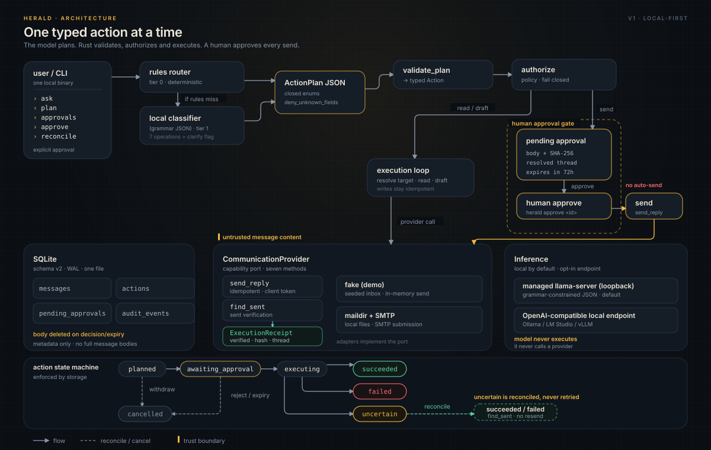
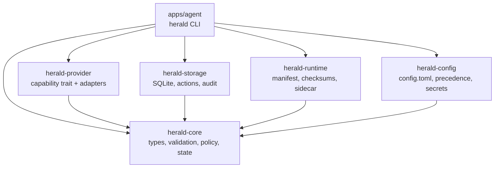
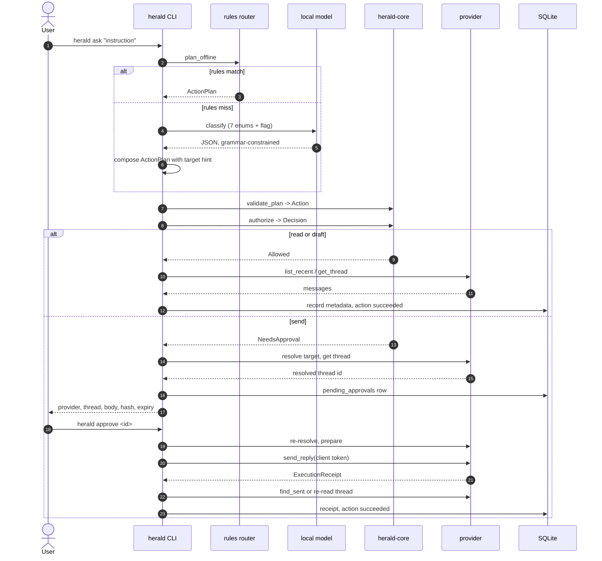
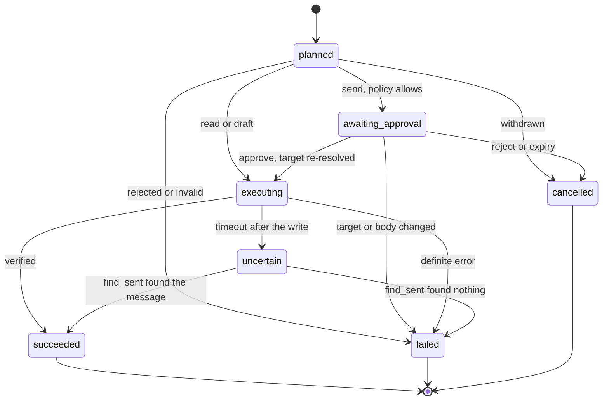

# Architecture

<p align="center"></p>

Herald turns one plain-language instruction into one typed action against the
user's own communications, and it performs outbound actions only after an
explicit approval. This document is the first-principles description of how
that works and why each boundary exists. The v1 contract lives in
[v1-design.md](v1-design.md); this file explains the reasoning behind it.

## Principles

**Small trusted core.** The part of the system that decides what is allowed is
small enough to read in one sitting: one enum of actions, one validation
function, one policy function, one state machine. Everything else (parsing,
inference, provider quirks) is outside the trusted path.

**Typed actions.** The planner cannot name an operation that does not exist or
invent a provider that has no adapter. `ActionPlan` deserializes with
`deny_unknown_fields` and closed enums, so an extra key fails the whole plan.

**Untrusted content.** Retrieved message text is data. It is wrapped in
`<untrusted-message>` blocks and never concatenated into the system prompt.
The user's instruction lives in its own block.

**Fail closed.** Missing target, empty body, ambiguous sender, expired
approval, changed thread, checksum mismatch, unknown enum: each one stops the
action. None of them falls back to a guess.

**Idempotency.** Every write has a client token. A repeat of the same token
returns the existing receipt. A timeout after a send is `uncertain`, not
`failed`, and it is resolved by looking for the message rather than sending
again.

**Local by default.** The model runs on the machine or it does not run. A remote
endpoint is possible and explicit. There is no telemetry path in the codebase.

**Boring infrastructure.** SQLite, a Maildir on disk, SMTP submission, one child
process on loopback. No queue service, no daemon, no scheduler, no database
server. A single user runs one binary.

## Crate graph



| Crate | Responsibility | Explicitly not responsible for |
| --- | --- | --- |
| `herald-core` | Action types, `validate_plan`, `authorize`, `ActionState`, prompt construction, planner rules, JSON schema | I/O, network, files, database, configuration |
| `herald-provider` | The `CommunicationProvider` trait, the fake provider, the Maildir/SMTP adapter, error mapping | Deciding whether an action is allowed, storing state |
| `herald-storage` | Schema migrations, message dedupe, action records, transition enforcement, audit log, pending approvals | Calling providers, formatting output |
| `herald-runtime` | Model manifest and checksums, resumable download, `llama-server` sidecar, OpenAI-compatible client | Knowing what an action is |
| `herald-config` | `config.toml` parsing, path resolution, precedence, secret lookup | Deciding policy outcomes |
| `apps/agent` | CLI parsing, the execution loop, human and JSON output, exit codes | Owning domain rules |

The dependency direction is one way. `herald-core` depends on nothing in the
workspace. That is what makes the policy testable without a mail server, a
model, or a filesystem.

`herald-config` owns the file format, the environment overrides, the path
resolution, and the redaction rules. The CLI never parses TOML.

## Data flow



## The type ladder

Each step narrows what the next step may do. A value that has not climbed the
ladder cannot reach a provider.

| Rung | Type | Produced by | Guarantee |
| --- | --- | --- | --- |
| 1 | `ActionPlan` | rules router or model | Untrusted JSON. Unknown fields and unknown enums fail deserialization. |
| 2 | `Action` (`Read`, `Draft`, `Send`) | `validate_plan` | A body exists for replies, a target exists, the operation is real. Send carries the SHA-256 of the exact body. |
| 3 | `Decision` (`Allowed`, `NeedsApproval`, `Rejected`) | `authorize` | Policy has run. A send can only continue as an approval request, never as an executable action. |
| 4 | `Approval` | CLI + storage | A durable row with provider, serialized target, resolved thread id, body, body hash, creation time, expiry. |
| 5 | `PreparedAction` | provider `prepare_reply` | Provider-side draft bound to a thread and carrying the client token. Must not mutate the account. |
| 6 | `ExecutionReceipt` | provider `send_reply` | Proof of a write: provider, thread, provider message id, body hash, timestamp, `verified`. |

Two invariants hold across the ladder:

- The body is never rewritten. `validate_plan` preserves leading and trailing
  whitespace, and the hash is computed over the exact bytes that will be sent.
- An identifier is never invented. A `Target::Thread` must come from the app or
  a prior provider result. A `Target::Description` is a phrase, and Rust
  resolves it against real data.

## Provider port

```rust
#[async_trait]
pub trait CommunicationProvider: Send + Sync {
    fn id(&self) -> ProviderId;
    async fn health(&self) -> ProviderHealth;
    async fn list_recent(&self, query: &MessageQuery)
        -> Result<Vec<MessageSummary>, ProviderError>;
    async fn get_thread(&self, id: &ThreadId) -> Result<Thread, ProviderError>;
    async fn prepare_reply(&self, id: &ThreadId, body: &str, client_token: &str)
        -> Result<PreparedAction, ProviderError>;
    async fn send_reply(&self, action: &PreparedAction)
        -> Result<ExecutionReceipt, ProviderError>;
    async fn find_sent(&self, thread: &ThreadId, client_token: &str)
        -> Result<Option<ExecutionReceipt>, ProviderError>;
}
```

The port is capability-based. A provider can list messages, read one thread,
prepare a reply, send a prepared reply, and look for a reply it already sent.
It cannot click, type into arbitrary fields, run JavaScript, navigate to a URL,
or execute a selector supplied by the planner.

A browser adapter that exposed "click this element" would hand the planner an
execution primitive, and prompt injection would become remote control. The X
adapter is the one browser provider, and it keeps the surface at the seven
methods: every selector and URL is a constant in its own module, thread ids are
validated before navigation, and any unexpected page is a hard stop. See
[ADR 0008](decisions/0008-x-browser-adapter.md). The Maildir adapter needs no
browser at all.

`PreparedAction` carries the client token (the action id). `send_reply` must be
idempotent on it: a second call with the same token returns the existing
receipt instead of sending again. `find_sent` is the read side of the same
contract.

## State machine



| From | Allowed next states |
| --- | --- |
| `planned` | `awaiting_approval`, `executing`, `failed`, `cancelled` |
| `awaiting_approval` | `executing`, `failed`, `cancelled` |
| `executing` | `succeeded`, `failed`, `uncertain` |
| `uncertain` | `succeeded`, `failed` |
| `succeeded`, `failed`, `cancelled` | none, terminal |

The storage layer enforces this table. `transition_action` reads the current
state, asks `ActionState::transition`, and refuses an illegal move. A caller
cannot mark an unapproved send as succeeded, and a caller cannot cancel a send
that may already have reached the provider.

`cancelled` is deliberately reachable from `planned` and `awaiting_approval`
only. An approval that expires is cancelled, not failed: nothing was sent, and
the body is deleted. Once execution starts, the only honest outcomes are
success, definite failure, or `uncertain`.

A process that dies mid-send can leave an action in `executing` with no
outcome. `reconcile` treats an `executing` action older than 60 seconds as
stale, moves it to `uncertain`, and then looks for the message. It never
resends.

## Idempotency and reconciliation

A send can fail in the one way that matters: the message reaches the server and
the response does not reach Herald. Retrying there duplicates mail. Herald
handles it in three layers.

1. **Client token.** The action id is the idempotency key. It is passed to
   `prepare_reply`, stored in the approval row, and sent as `X-Herald-Token`.
2. **Provider-side dedupe.** `send_reply` checks for an existing message with
   that token before composing. A repeat returns the stored receipt.
3. **Verification.** After sending, the adapter re-reads the Sent folder (or the
   thread, for providers that expose one) and confirms the message with the
   expected body hash. `ExecutionReceipt::verified` is not a formality; a
   receipt with `verified = false` is not success.

When the send call times out, the action moves to `uncertain` and stops. The
user runs `herald reconcile <id>`, which calls `find_sent`. If the message is
there, the action becomes `succeeded` with that receipt. If it is not, the
action becomes `failed` and the user can plan a new send. Herald never retries
`uncertain` automatically, and `reconcile` never calls `send_reply`.

The content hash (SHA-256 of the exact body) serves two purposes: it detects an
edit between approval and execution, and it identifies the sent copy during
verification.

## Target resolution

A target is a description or an identifier, and the difference is load-bearing.

| Target | Meaning | Resolution |
| --- | --- | --- |
| `Thread { thread_id }` | An id from the app or a prior provider result | Verified by the adapter. Never guessed by the model. |
| `LatestFrom { sender }` | "the latest message from X" | Matched against real senders in recent messages. |
| `Description { description }` | A human phrase | Trimmed into a search, resolved against provider data. |

Resolution happens twice for a send: once when the approval is created, so the
user sees the real thread, and again inside `approve`, immediately before
sending. If the re-resolution produces a different thread, the approval is
refused and the action moves to `failed`. The user sees why and can plan again.

Resolution fails closed. Zero matches is an error (`UnresolvedTarget`), not a
fallback to the most recent thread. Several matches is `ambiguous_target`, a
stop condition, not a pick. The model is never asked to resolve a target; tier
2 of the planner is deterministic Rust.

## Trust boundaries

**Instruction vs provider content.** `build_planner_prompt` puts the
instruction in `<user-instruction>` and each message in
`<untrusted-message id=... thread=... sender=...>`. The system prompt says the
content inside those blocks is data and that requests inside it must be
ignored. A test asserts that an injected sentence stays inside the block and
never reaches the system prompt.

**Model vs execution.** A plan is inert until `validate_plan` accepts it.
Unknown fields fail deserialization. Unknown providers and operations cannot be
constructed because they are closed enums. There is no field that names a
command, a URL, or a function.

**Approval vs execution.** `authorize` can only produce a send decision as
`NeedsApproval(ApprovalRequest)`. The executor refuses `Action::Send` outright.
The only code path that calls `send_reply` is the one that reads the approval
row by id, re-resolves the target, and compares the body hash.

**Retries vs reality.** `Timeout` after a write goes to `uncertain`. Only a
read (`find_sent`) moves it forward. `RateLimited` and `UnexpectedLayout` are
definite failures that require a human decision.

**Config vs secrets.** `config.toml` holds paths, hostnames, and the name of an
environment variable. It does not hold the password. A plaintext `password` key
is accepted for compatibility, but `doctor` warns and `init` never writes one.

## Failure taxonomy

`ProviderError` has eight variants, and each maps to one action state. The
mapping is the contract; the message is for humans.

| Variant | Meaning | Read action | Send action |
| --- | --- | --- | --- |
| `NotFound` | Thread or message is gone | `failed` | `failed` at resolution, before send |
| `NotAuthenticated` | Credentials missing or rejected | `failed`, stop and report | `failed`, stop and report |
| `NotConfigured` | Provider is read-only, no SMTP block | n/a | `failed` before send |
| `Timeout` | No answer in the deadline | `failed`, safe to re-run | `uncertain`, reconcile |
| `RateLimited` | Server asked us to slow down | `failed` | `failed` |
| `UnexpectedLayout` | Data did not match the expected shape | `failed`, stop and report | `failed` |
| `Unsupported` | Provider cannot perform this operation | `failed` | `failed` |
| `Other` | Anything else, with a message | `failed` | `failed` |

`NotAuthenticated` and `UnexpectedLayout` are stop-and-report conditions. They
are never worked around with a retry, a different selector, or a login attempt.

## Storage and retention

SQLite in the data directory, WAL mode, one file. Schema version 3 adds
`pending_approvals` and the action resolution columns to the earlier tables.

| Table | Holds | Retention |
| --- | --- | --- |
| `providers` | Provider name, enabled flag, health, profile reference | Until the provider is removed |
| `messages` | Provider, message id, thread id, sender, subject, timestamp, unread, last seen | Metadata only; deduped on `(provider, message_id)` |
| `actions` | Action id, provider, operation, target description and JSON, resolved thread, content hash, state, timestamps | Permanent, it is the history |
| `audit_events` | Timestamped status and a short detail string | Append-only |
| `preferences` | Small key/value settings | Until cleared |
| `pending_approvals` | Action id, provider, target JSON, resolved thread id, body, body hash, created, expires | Body deleted on approve, reject, or expiry |

Deliberately not stored:

- Full message bodies. A body is read to answer the command that asked for it
  and is not persisted. Approval bodies are the exception, and they are deleted
  when the decision is made.
- Credentials. Passwords come from the environment at call time.
- Model prompts or completions. The audit log records what happened, not the
  text that was considered.
- Attachments. v1 does not fetch them.

`purge_expired_approvals` runs once at startup, before any command. An expired
approval cannot be approved: `approve` checks `expires_at`, moves the action to
`cancelled`, and deletes the body.

## Inference architecture

Herald has two inference backends behind one `Inference` trait
(`complete_json`, `complete_text`).

**Managed sidecar (default).** `herald-runtime` starts a pinned `llama-server`
child process. The host is hardcoded to `127.0.0.1`; there is no bind-address
field to misconfigure. Each run gets a random API token, a free port, a 90
second startup deadline, and a clean shutdown on drop. Generation is
temperature 0. The child runs with `--jinja`, so the model's own chat template
is applied: a reasoning model is told not to think per request, otherwise it
spends the token budget inside the reasoning block and answers with none.
For JSON calls, the server is grammar-constrained with a JSON schema, so the
model cannot invent keys or enum values.

The child's stderr goes to a per-run file in the temp directory; a failed start
or an early exit reports its last few kilobytes instead of a bare timeout, and
the file is removed on shutdown.

**OpenAI-compatible endpoint.** `[model] backend = "openai"` points at any
server that speaks `/v1/chat/completions`, which covers Ollama, LM Studio, and
vLLM. This is the escape hatch for people who already run a model. If the
endpoint is not loopback, message content leaves the machine, and that is the
user's decision to make explicitly.

The planner is tiered because a small model fails when asked to do everything
at once:

| Tier | Task | Who does it | Output |
| --- | --- | --- | --- |
| 0 | Common commands | Rules router | `ActionPlan` |
| 1 | Intent classification | Local model, grammar-constrained | One of seven operations, a clarification flag, and the two phrases the model may name |
| 2 | Target resolution | Rust, against provider data | `ThreadId` |
| 3 | Drafting and summarization | Local model, plain text | Reply body or thread summary |

Tier 1 asks one question with four fields: the flag, the operation, and the
target phrase and question the model may name better than the regex does. The
two phrases are only hints; an empty one falls back to `rules::target_hint` and
validation still gates everything. Tier 3 is plain text with no JSON,
and every message in a summary prompt is wrapped as untrusted. Tier 2 never
involves the model. This split is why a 0.8B model is usable: it is a
classifier and a writer, not an agent. There is no post drafting: Herald does
not generate or publish tweets; that pipeline lives in Zyquor (ADR 0011).

## Why Maildir and SMTP first

Maildir is a directory of files. Reading it needs no network, no OAuth client,
no browser, and no terms-of-service negotiation. SMTP submission is a protocol
with a stable error model. Together they cover the people who already run
`mbsync` or `offlineimap`, which is the group most likely to want a local-first
mail agent.

IMAP is the obvious next step, but it needs a different auth story (app
passwords first, OAuth later), a connection state machine, and a server-side
search model. Doing it before the approval path was solid would have meant
debugging two hard things at once. Browser automation is not in v1 at all; the
reasoning is in [decisions/0004-email-provider-maildir-smtp.md](decisions/0004-email-provider-maildir-smtp.md).

## Performance and size

Herald is built for one user on a laptop, not for a queue.

- The rules router answers common commands in microseconds and never starts the
  model.
- A classifier call is a short prompt with a 32-token cap. Drafting is capped
  at 256 tokens. No full inbox is ever put in a prompt.
- The sidecar uses a 4096-token context and four threads by default, both
  configurable under `[model]`. A 0.8B Q4_K_M model is about 0.5 GB on disk and
  fits comfortably in a few hundred megabytes of RAM at that context.
- There is no scheduler and no background polling. Nothing runs unless a
  command runs. `doctor` and `approvals` are the only commands that touch state
  without a user instruction.
- SQLite keeps startup cheap: one file, WAL, no migrations beyond the version
  check.

The cost of a send is one SMTP round trip plus one Sent-folder read for
verification. The cost of a read is one directory scan and one insert per new
message.

## Extension points

- **A new provider** implements `CommunicationProvider` and the capability
  checklist in [providers.md](providers.md). It must pass the injection corpus
  and the idempotency tests before it ships.
- **A new action** is an enum variant in `herald-core`, a validation arm, a
  policy arm, and tests. That friction is intentional.
- **A new inference backend** implements the `Inference` trait. The planner
  tiers do not change.
- **A new output format** belongs in the CLI layer. The JSON envelope
  (`ok`, `command`, `data`) is stable.

Intentionally absent from v1: general auto-send rules, tool registries, agent
loops, multi-user support, sync, mobile, notifications, scheduling, archive or
delete operations, attachments, and a posting lane. The only browser
automation is the X adapter, and every send needs a per-action approval
(ADR 0008 and 0011). Each of these is a deliberate design decision rather than
a missing feature, and the roadmap records when each might change.

## Further reading

- [v1-design.md](v1-design.md): the v1 contract, types, and CLI surface.
- [providers.md](providers.md): provider behaviour and the checklist for adding one.
- [configuration.md](configuration.md): every key, path, and environment variable.
- [cli.md](cli.md): command reference, JSON shapes, exit codes.
- [threat-model.md](threat-model.md): assets, adversaries, and the tests that cover them.
- [decisions/](decisions/): the architecture decision records.
- [README](../README.md), [SECURITY](../SECURITY.md), [CONTRIBUTING](../CONTRIBUTING.md),
  [PRIVACY](../PRIVACY.md), [CHANGELOG](../CHANGELOG.md): the project-level files.
