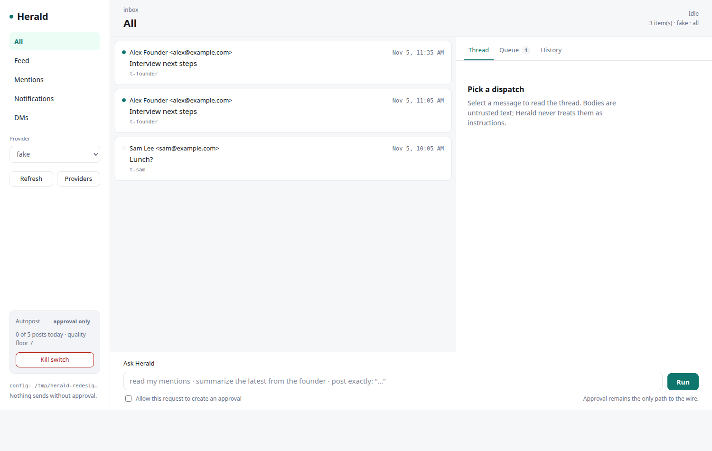

# The local UI

`herald ui` serves a browser interface from the same binary, on loopback, over
the same commands and approvals the terminal uses. It is the GUI today; a Tauri
desktop shell can wrap the same page and API later
([ADR 0010](decisions/0010-local-web-ui.md)).



## Start it

```bash
herald ui
# Herald UI  http://127.0.0.1:7878/?token=…
```

Open the printed URL. The token is per run and required by every API call; a
URL without it is refused. `--port 0` picks a free port. `--open` launches the
printed URL with `xdg-open` (failures are ignored and the server keeps
running; Unix only). `Ctrl+C` stops it.

On every start the server writes the full URL — including the per-run token —
to `<data-dir>/ui-url` (mode `0600`, replaced atomically). To run the UI
permanently as a systemd user service, see
[contrib/README.md](../contrib/README.md): it runs `herald ui --port 8787`,
and the URL is `cat ~/.local/share/herald/ui-url` (or `journalctl --user -u
herald-ui.service`).

## What it does

| Area | Behaviour |
| --- | --- |
| Scopes | All, Feed, Mentions, Notifications. Same `herald inbox --scope` reads. DMs are out of scope. |
| Provider | `x`, `fake`, or `maildir`; the default follows the config, preferring `x` when `[x]` is configured. |
| Threads | Clicking an item runs `herald thread`; message bodies are untrusted text. |
| Queue | Pending approvals with the exact body, hash, and expiry. Review opens a confirmation dialog; approve runs `herald approve`, reject runs `herald reject`. |
| Ask | Runs `herald ask`; “Allow this request to create an approval” maps to `--enable-send`. |
| Autopost | Shows the rails and writes the kill switch (`herald autopost off`). |
| Providers | Health table from `herald providers` (X launches a browser; expect a delay). |
| Filter | Client-side filter over the loaded list; `/` focuses it, `Esc` clears. |
| Freshness | Approve, reject, reconcile, and ask clear the read cache before reloading. Notifications show unread on the check that finds them, then read on the next check. |
| History | Recent actions with state. `uncertain` sends expose Reconcile, which runs `herald reconcile` and never retries. |

Keyboard: `j`/`k` move, `Enter` opens, `/` filters, `r` refreshes, `q` queue,
`h` history, `t` thread. Deep links: `/?token=…&provider=x&scope=feed&thread=mention:123`
and `&tab=queue`. When approvals are waiting, the queue opens on load.

## Browser budget and read cache

The UI never polls X and never refreshes itself. One browser run happens when
the UI starts (for the current scope), and then only when you press Refresh or
open a thread that is not cached.

- Read results are cached in memory for 5 minutes per provider/scope; switching
  scopes or tabs inside that window does not launch Chrome.
- Thread views are cached the same way.
- The header shows `checked 2m ago`; Refresh bypasses the cache and checks once.
- `x.headless = true` keeps those runs invisible; only `herald x login` opens a
  window.
- Requests are serialised server-side, so two tabs cannot start two browsers on
  the same profile.
- Closing the UI tab loses the cache; it does not stop or schedule anything.

## Security properties

- Binds `127.0.0.1` only. It cannot be reached from another machine.
- Per-run 128-bit token in the URL, injected into the page, required in
  `X-Herald-Token` for every API call. Wrong or missing token: 403.
- `Origin`, when present, must match the loopback origin.
- Content Security Policy `default-src 'self'`; no inline script, no external
  assets, no telemetry.
- The server holds no domain logic. Every action is a subprocess of the same
  CLI, so the approval queue, body hash, autopost rails, and idempotency ledger
  are identical to the terminal.
- Rendered message content uses `textContent`, never `innerHTML`.
- Request bodies are capped at 64 KiB and inputs are validated.
- An integration test starts the real server and checks that the token is required (no token gets a 403), that the page serves the strict CSP, and that the autopost kill switch is written through the API.

## Limits

- Not a network service: no accounts, no TLS, no remote access.
- One command at a time, so an X read blocks the first paint.
- DMs are out of scope: the owner does not need them, and X renders them in an
  embedded `xchat` app the adapter does not parse. The API scope remains for
  completeness but the UI does not expose it.
- `herald x login` stays in the terminal: it needs a visible browser window and
  a human.
